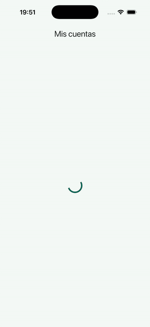
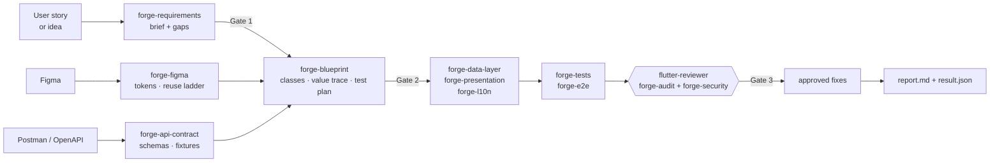

# flutter-forge

[](https://github.com/Jols7/flutter-forge/actions/workflows/ci.yml)
[](LICENSE)


**flutter-forge** is an AI Flutter engineer, packaged as a Claude Code plugin. It takes one
requirement through to a reviewed feature:

| Input | Output |
|---|---|
| User story (or a one-line idea it turns into a story) | Requirement brief with gaps |
| Figma design | Class blueprint |
| Postman / OpenAPI contract | Clean Architecture code (BLoC, Riverpod or Provider) |
| | Unit, widget and Patrol tests |
| | Independent code audit |
| | OWASP MASVS security review |
| | Traceability report |

It works in **any** Flutter project. Project knowledge lives in the project's own
`.flutter-forge/` folder, never in the plugin. A larger orchestrator, such as a fullstack or
multi-repo agent, can call it as a **subagent**.

> Spanish summary: agente de IA para Flutter que baja un requerimiento completo, de la HU, el
> Figma y Postman hasta el código con Clean Architecture. Lo prueba, lo audita y le hace una
> revisión de seguridad. Se adapta a cada proyecto con un perfil y puede usarse como
> subagente de un orquestador.

<p align="center">
  
  <br>
  <sub>Real recording of the demo app's Patrol E2E flow on an iOS simulator, generated with
  <code>forge-e2e</code> (step pacing enabled for readability). Test result: <code>RESULT: GREEN</code>.</sub>
</p>

---

## How it works



The pipeline has three gates where you approve or redirect the work:
1. the brief and its gaps;
2. the class blueprint;
3. which review findings to fix.

In unattended mode, for example when an orchestrator calls it, nothing waits for an answer.
Assumptions are recorded, and only blocking gaps stop the run.

## What's inside

| Skill | What it does |
|---|---|
| `forge-deliver` | Orchestrates the whole pipeline, resumable from `.flutter-forge/runs/<slug>/` |
| `forge-profile` | Detects the stack and architecture; asks whether to adopt, improve or migrate; writes the profile |
| `forge-architecture` | Clean and Layered presets for BLoC, Riverpod and Provider; machine-checked layer rules; `Result`/`AppFailure` |
| `forge-requirements` | Reads a story (file, issue, Drive, paste) or drafts one (INVEST + Gherkin); writes the brief and the gaps |
| `forge-figma` | Figma MCP with the cheapest calls first; tokens by name; native M3 widgets; widget catalog; CSS mode |
| `forge-api-contract` | Postman v2.1, v3, cloud (CLI/MCP), OpenAPI or pasted JSON → schemas, nullability, redacted fixtures |
| `forge-blueprint` | Every class of the feature, the screen-value → DTO trace, and a test plan mapped to ACs |
| `forge-data-layer` | Entities, contracts, DTOs, mappers, data sources, repositories, the `guard()` helper, mock-first networking |
| `forge-presentation` | Sealed states, pages, widgets, navigation, failure → message mapping, accessibility |
| `forge-l10n` | gen-l10n or intl_utils; placeholders, plurals, locale-aware formatting |
| `forge-tests` | Mapper, repository, state and widget tests with mocktail, bloc_test and fixtures; coverage gate |
| `forge-e2e` | Patrol flow tests: session created by API, checkpoints with recovery, prod refused |
| `forge-audit` | Analyzer + layer checker + checklist + design lenses → ranked findings and a verdict |
| `forge-security` | MASVS v2: secret, platform-config and dependency scanners plus a review of the whole flow |
| `forge-learn` | Records a project convention as an overlay, so the agent improves without forking |

| Agent | Role |
|---|---|
| `flutter-engineer` | The entry point for people and orchestrators. Accepts a brief and returns `result.json` |
| `flutter-reviewer` | Read-only reviewer that runs in a clean context, for independent audit and security review |

Five stdlib-only Python scripts back the skills, each with unit tests:
- `detect_project.py`
- `postman_to_contract.py`
- `check_layers.py`
- `scan_secrets.py`
- `check_platform_config.py`

A shell runner (`run_flow.sh`) drives the Patrol tests, and `add_ios_ui_test_target.rb`
creates the iOS UI-testing target that Patrol needs.

## Install

```bash
# inside Claude Code
/plugin marketplace add Jols7/flutter-forge
/plugin install flutter-forge@flutter-forge
```

To develop the plugin, or try it without installing:

```bash
git clone https://github.com/Jols7/flutter-forge && cd flutter-forge
claude --plugin-dir ./plugins/flutter-forge
```

## Use it

**As a person.** Open Claude Code in your Flutter project:

```
/flutter-forge:forge-deliver Implementa la HU docs/stories/HU-12.md con la colección api/app.postman_collection.json
```

The first run creates `.flutter-forge/profile.yaml` after detecting your stack. For an existing
codebase it asks whether to **adopt** the current architecture, **improve** it without breaking
call sites, or **migrate** new features to Clean.

**As a subagent.** Call `flutter-forge:flutter-engineer` with a brief, then read
`.flutter-forge/runs/<slug>/result.json`:

```yaml
project: apps/mobile
feature: Nueva transferencia entre cuentas propias
sources: { story: docs/stories/HU-12.md, api: api/collection.json }
mode: unattended
phases: all
```

For an independent review afterwards, run `flutter-forge:flutter-reviewer`. The full contract
is in [docs/subagent-contract.md](docs/subagent-contract.md).

**Single skills.** Every skill also works on its own. Examples: "audita la seguridad de este
feature", "genera el contrato desde Postman", "¿dónde va esta clase?".

## Adapting it to a project

```
your_app/.flutter-forge/
├── profile.yaml          # values: preset, state manager, paths, commands, l10n, security level
├── layers.json           # optional: import rules mapped to your real folders
├── overlays/<skill>.md   # optional: your conventions, extending or replacing a skill's rules
└── runs/<feature>/       # brief, contract, blueprint, findings, report, result.json
```

Precedence: your request > overlay > profile > preset > skill default. `forge-learn` writes
overlays for you. See the
[profile schema](plugins/flutter-forge/skills/forge-profile/references/profile-schema.md) and
[overlays](plugins/flutter-forge/skills/forge-learn/references/overlays.md).

## Example app

[`example/forge_demo`](example/forge_demo) is a small personal-finance app (accounts →
transactions). It is built with exactly the code the skills generate: Cubit, get_it, go_router,
Dio, `Result`/`AppFailure`, gen-l10n and mock-first networking. CI checks it on every push:

- `flutter analyze` with strict casts, inference and raw types: **0 issues**;
- **29 tests** (mappers against the contract fixtures, repositories for every failure type,
  Cubit including pagination and close safety, widgets including accessibility guidelines);
- **82.6 %** line coverage of domain + data;
- the plugin's own layer checker, secret scanner and platform-config checker: **clean**;
- a **Patrol E2E flow** (`patrol_test/flows/account_transactions_test.dart`) built on the
  `forge-e2e` harness, with checkpoints and a recovery ladder. It passes on the iOS simulator
  and is the recording at the top of this page. Run it with:

  ```bash
  plugins/flutter-forge/skills/forge-e2e/scripts/run_flow.sh \
    --test patrol_test/flows/account_transactions_test.dart --env patrol_test/demo_env.json
  ```

It also includes a sample story (`docs/stories/HU-01-transfer.md`) with deliberate gaps, so you
can watch a `forge-deliver` run surface them.

## Quality of the plugin itself

- `claude plugin validate --strict` runs on the marketplace and on the plugin.
- Unit tests cover every script (Python 3.9 and 3.12), and `shellcheck` covers the runner.
- A CI guard (terms kept in a repository secret) fails if project-specific names leak into generic skills.
- [Evals](plugins/flutter-forge/evals) cover requirement drafting, contract inference,
  architecture placement, code-review findings and security findings. They run manually or
  weekly (`evals.yml`), because they cost tokens.
- During development the scanners were also run read-only against a large real-world Flutter
  codebase (~600 Dart files) to measure noise on code they had never seen. Every false
  positive found there was fixed and turned into a regression test.

## Design decisions

- [ADR 0001](docs/adr/0001-independent-generic-plugin.md): a generic plugin; project knowledge
  stays in the project.
- [ADR 0002](docs/adr/0002-result-type-errors.md): a home-grown sealed `Result<T>` and
  `AppFailure` instead of thrown strings or fpdart.
- [ADR 0003](docs/adr/0003-review-in-separate-context.md): review in a separate read-only agent,
  with automation first.
- [Architecture](docs/architecture.md): components, pipeline, gates and the constraints of the
  host.

## Roadmap

- A recorded demo run of `forge-deliver` (story → reviewed feature) on the example app.
- Patrol E2E in CI (macOS runner + simulator) and an Android emulator run.
- Ops skills: flavors and release builds (APK/IPA) with obfuscation by default.
- Optional hooks: `dart format` / analyze after edits, and a guard against writing secrets.
- Dart & Flutter MCP server integration: analyzer, tests and widget-tree inspection.
- More presets: feature-sliced modules, melos monorepos.

## Contributing and credits

See [CONTRIBUTING.md](CONTRIBUTING.md) for how to add a skill, preset or check (each comes with
an eval) and [SECURITY.md](SECURITY.md) for reporting.

The review checklist and the design lenses adapt ideas from
[ECC](https://github.com/affaan-m/ECC) and
[flutter-llm-toolkit](https://github.com/rolandtolnay/flutter-llm-toolkit), both MIT. See
[NOTICE](NOTICE).

MIT © 2026 Joel Anaya
