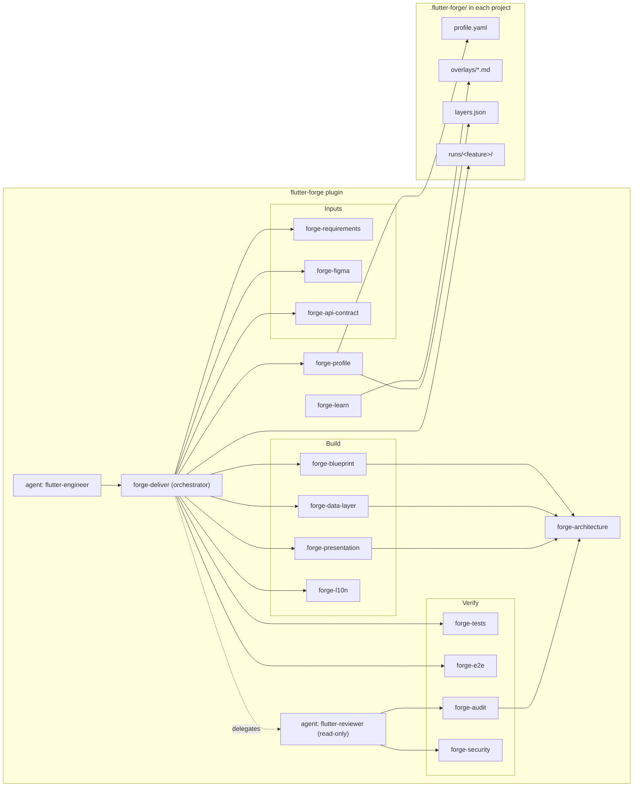

# flutter-forge — architecture

## Goal

flutter-forge turns one requirement into a finished Flutter feature, end to end:
1. **Inputs:** a user story (existing or generated), a Figma design, and a Postman/OpenAPI
   contract or ad-hoc endpoints.
2. **Code:** screens, state managers, widgets, repositories, data sources, entities, DTOs and
   mappers.
3. **Tests:** unit, widget and Patrol.
4. **Review:** an independent code audit, then a security review.

It works in any Flutter project. Each project's specifics live in that project, never in the
plugin.

## Components

## Pipeline and gates

| Phase | Skill | Output (in `.flutter-forge/runs/<slug>/`) | Gate (interactive) |
|---|---|---|---|
| 0 Profile | forge-profile | `profile.yaml` (once per project) | Mode question (adopt/improve/migrate) on first use |
| 1 Requirement | forge-requirements | `brief.md` | **Gate 1**: brief + gaps |
| 2 Design | forge-figma | `design.md` | — |
| 2 Contract | forge-api-contract | `contract.md` + `test/fixtures/` | — |
| 3 Blueprint | forge-blueprint | `blueprint.md` | **Gate 2**: classes and test plan |
| 4 Implement | forge-data-layer → forge-presentation → forge-l10n | code | — |
| 5 Test | forge-tests → forge-e2e | `tests.md` | — |
| 6 Review | forge-audit + forge-security (in flutter-reviewer) | `findings.md` | **Gate 3**: which findings to fix |
| 7 Fix | the skill that owns each finding | code + re-run tests | — |
| 8 Report | forge-deliver | `report.md` + `result.json` | — |

In `unattended` mode no gate asks. Gaps go to **Open questions**. Blocking gaps stop the run with
`status: blocked`. Only `critical` and `high` findings are fixed automatically.

## Design principles

1. **The project's knowledge lives in the project.** The plugin ships rules and presets; the
   `.flutter-forge/` folder holds values and overrides.
2. **Ask about gaps instead of guessing.** Mock data in a design is not a business rule.
3. **The model comes from the design and the DTO from the contract.** Mappers absorb the
   difference, so a backend change touches only data files.
4. **Review is done by a different context.** The reviewer agent has never seen the
   implementation reasoning, so it reviews the code as written.
5. **Automation runs before judgement.** Analyzer, layer checker and secret scanner run first;
   the LLM review covers what tools can't.
6. **Every skill is usable alone.** forge-deliver composes them but is not required.
7. **Spend context deliberately.** References load on demand. The cheapest Figma calls come
   first. Long work keeps its state in run files so a new session can resume.

## Constraints of the host (Claude Code)

- A subagent cannot spawn subagents. When `flutter-engineer` itself runs as a subagent of
  another orchestrator, it runs the audit inline and says so in `result.json`
  (`review.independent: false`). For an independent review, the orchestrator should launch
  `flutter-reviewer` separately.
- Figma, Google Drive and Postman cloud need connectors (MCP) or CLIs authenticated by a person.
  In unattended runs, prefer files committed in the repo: exported HU, Postman collection,
  OpenAPI spec.
