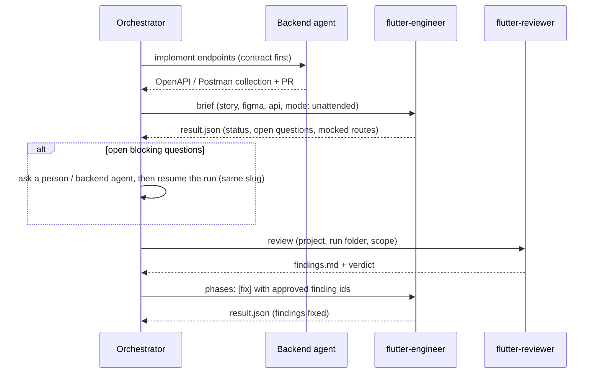

# Using flutter-forge from an orchestrator

flutter-forge ships two agents that an orchestrator, such as a fullstack or multi-repo agent,
can call:

| Agent | Tools | Use it for |
|---|---|---|
| `flutter-forge:flutter-engineer` | all | Deliver a feature (or a subset of phases) in a Flutter project |
| `flutter-forge:flutter-reviewer` | Read, Grep, Glob, Bash (read-only use) | Independent audit + security review of a Flutter diff, folder or run |

Every skill can also be invoked on its own (`/flutter-forge:forge-api-contract`, …) when an
orchestrator only needs one capability.

## Input brief

Send the engineer a YAML (or equivalent prose) brief:

```yaml
project: apps/mobile
feature: Nueva transferencia entre cuentas propias
sources:
  story: docs/stories/HU-12.md        # path | text | issue URL | none
  figma: https://www.figma.com/design/<file>?node-id=12-345
  api: api/collection.postman_collection.json
mode: unattended
phases: all                            # or e.g. [requirements, contract, blueprint]
git: none                              # none | commit | pr
explain: brief                         # none | brief (default) | full
constraints:
  - "Backend PR #88 adds POST /transfers; until merged, use the agreed mock in docs/api/transfers.md"
```

| Field | Rules |
|---|---|
| `project` | Folder with `pubspec.yaml`. Its `.flutter-forge/profile.yaml` is created on first use (with `adopt` for existing apps, in unattended mode) |
| `sources.story` | `none` lets the agent draft the story from `feature` + constraints. Every business number it cannot source becomes an open question |
| `mode` | `unattended`: no questions, assumptions recorded, `blocked` on blocking gaps, auto-fix of critical/high only |
| `phases` | Subset semantics: phases run in pipeline order. Phases whose inputs are missing are skipped and listed in `result.json` |
| `git` | `none`: nothing; the message is proposed in `proposed_commit`. `commit`: Conventional Commits with scope `mobile` on a `<type>/<HU>-<slug>` branch, no push. `pr`: also pushes and opens a PR (body *Qué / Por qué / Dónde revisar*); never merges. A project with its own convention keeps it |
| `explain` | Depth of `why[]` and `review_points[]` ("Por qué / Dónde revisar"): `none` empty, `brief` 1–3 each, `full` every gate decision with alternatives (since v0.2.0) |

## Output

The engineer replies with a short message and writes the files below.
`.flutter-forge/runs/<slug>/result.json` is the machine-readable contract. Its schema is in
`plugins/flutter-forge/skills/forge-deliver/references/result.schema.json`.

```
.flutter-forge/runs/<slug>/
├── state.json      # resumable state
├── brief.md        # requirement brief + gaps + decisions
├── hu.md           # drafted story (when none existed)
├── design.md       # Figma decisions (when a design was given)
├── contract.md     # endpoints + fixtures (when an API was given)
├── blueprint.md    # classes, value trace, test plan
├── tests.md        # AC → tests, results, coverage
├── findings.md     # audit + security findings
├── report.md       # human report
└── result.json     # machine result
```

An example that validates against the schema is
`plugins/flutter-forge/skills/forge-deliver/references/result.example.json`.

Key fields to branch on:
- `status`: `completed` / `completed-with-gaps` / `failing-tests` / `blocked`.
- `open_questions[].blocking`: what to send back to a person, or to the backend agent.
- `mocked_routes`: endpoints the backend still owes.
- `review.independent`: `false` when the engineer ran as a subagent. Launch the reviewer next.
- `review.verdict` and `review.findings[].status`.
- `why[]` / `review_points[]`: decisions with discarded alternatives, and where a person must
  look. Each review point has a `point`, a `location` (`file:line`) and a `reason`. Since v0.2.0,
  same shape as the common orchestrator contract.
- `git.branch`, `git.commits[]`, `git.pr`: what was committed or opened, when `git` allowed it.

## Compatibility

- `schema: 1` is stable. Fields are only added, never renamed or removed, within a major
  schema version. v0.2.0 added `why`, `review_points` and `git`, which are optional.
- Both agents declare `model: sonnet`, so an orchestrator's cost model does not depend on the
  caller's default model.

## Recommended orchestration



- **Resume** by sending the same `feature` (same slug). The engineer continues from
  `state.json`.
- **Contract first.** When the backend agent publishes the collection or spec before the
  mobile work starts, the engineer builds against the real contract, and `mocked_routes`
  stays empty.
- **Independent review.** Claude Code subagents cannot start other subagents, so the
  orchestrator launches the reviewer itself.
